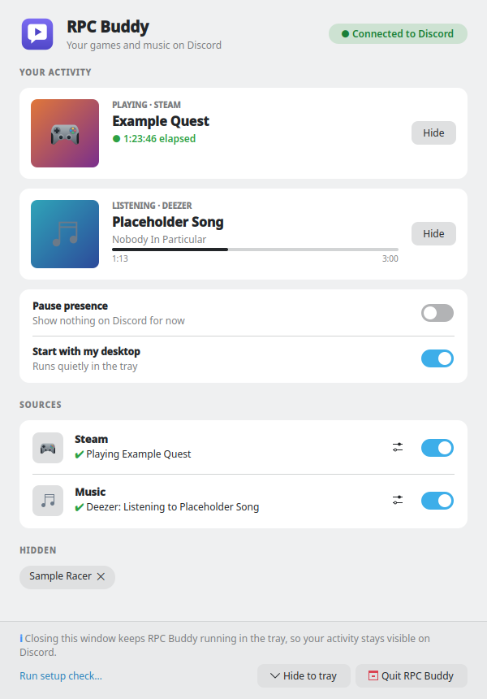

# RPC Buddy

Shows what you play and listen to on Linux as your Discord activity —
built for setups where Discord runs as a Flatpak and cannot detect games
itself.

**Status:** early development — test builds are on the
[Releases page](https://github.com/YetAnotherGerrit/rpc-buddy/releases); not
on Flathub yet.

<p align="center">
  <picture>
    <source media="(prefers-color-scheme: dark)" srcset="docs/screenshots/main-dark.png">
    
  </picture>
</p>

## Features

- **Steam games** appear as "Playing …" with the game's official Discord
  name and artwork, as if Discord had detected the game itself.
- **Music** from MPRIS players appears as "Listening to …" — e.g. Deezer,
  TIDAL or YouTube Music (also in a browser), Elisa, Rhythmbox, Strawberry
  and other music players. Spotify is optional: the setup check asks whether
  your Spotify account is linked to Discord (then Discord shows it itself);
  if not, RPC Buddy shows it.
- Game and music are shown **side by side**; the game wins the status line
  next to your name.
- **Main window** shows your activity like Discord's own activity cards —
  with **Hide** on each card for games or music sources you want to keep
  private. Activities that aren't sent to Discord (hidden, paused, invisible
  on Steam) stay visible, dimmed, with the reason — so pausing works as a
  preview. Follows your desktop's light/dark theme.
- **Respects Steam's Invisible status**: while you're invisible or offline on
  Steam, your game isn't shown on Discord either (can be switched off).
- **Tray icon** (KDE Plasma and other desktops with a system tray) with the
  current activity, pause and module switches; it shows an amber "!" while
  Discord can't be reached. Closing the window keeps RPC Buddy running there;
  **Quit** in the window or tray menu stops it.
- **Setup check** on first start: shows what was found and helps with
  anything missing — e.g. Steam in an unusual place is fixed by choosing its
  folder in your desktop's file dialog, no terminal needed.
- **Starts with your desktop session**, quietly in the tray (can be switched
  off).

## Requirements

- Linux desktop with Flatpak (tested on KDE Plasma; GNOME should work, without
  a tray icon unless the AppIndicator extension is installed — not tested yet)
- The official Discord client — the Flatpak `com.discordapp.Discord` works
  out of the box, no matter whether Discord or RPC Buddy starts first; Canary
  and Snap should work as well (untested). A Discord installed without Flatpak
  needs one extra permission and some care with the start order (see
  Troubleshooting).
- Steam (native or Flatpak) for game detection

## Install

Download `rpc-buddy.flatpak` from the
[latest release](https://github.com/YetAnotherGerrit/rpc-buddy/releases/latest)
and install it (the KDE runtime is fetched from Flathub automatically):

```bash
flatpak install --user rpc-buddy.flatpak
```

A newer release is installed the same way and replaces the old version.
There are no automatic updates yet.

### Build it yourself

```bash
flatpak install --user flathub org.kde.Sdk//6.11 io.qt.PySide.BaseApp//6.11
flatpak-builder --user --install --force-clean build-dir \
    flatpak/io.github.YetAnotherGerrit.RpcBuddy.yml
flatpak run io.github.YetAnotherGerrit.RpcBuddy
```

On the first start, the setup check opens. Close it with **Done**, and RPC
Buddy starts automatically from then on.

## How it works

| What | How |
|---|---|
| Running Steam game | Read from Steam's own log file (`logs/console_log.txt`), read-only. No Steam account, API key or network access needed. |
| Steam online status | Read from Steam's local settings file (`userdata/…/config/localconfig.vdf`), read-only — only to notice Invisible / Offline. |
| Game name and artwork | Discord's public list of games it can detect, downloaded at most once a day and cached. |
| Music | Read from the MPRIS interface that music players offer on the desktop session bus. |
| Showing it on Discord | Sent only to the Discord client running on your computer, over its local connection (IPC). |

### Privacy

RPC Buddy has no servers and no tracking. It only connects to:

- Discord's public game list (at most once a day),
- Discord's image server, to show game covers in its window,
- cover images that your music player itself provides as web links, to show
  them in its window (Discord loads them as well, to show them to your
  friends).

Your configuration stays in
`~/.var/app/io.github.YetAnotherGerrit.RpcBuddy/config/rpc-buddy/config.toml`.

## Limitations

- Games that Discord doesn't know are not shown.
- Music cover art only appears if the player provides it as a web link;
  browsers usually only provide a local file, which Discord can't show.
  RPC Buddy deliberately doesn't look covers up online — that would send what
  you listen to to a third party.
- Only the official Discord clients are supported.

## Troubleshooting

Open the main window (tray icon, or start RPC Buddy again) and click
**Run setup check…**. Common cases:

- **"Discord not reachable"** (amber "!" on the tray icon): start Discord —
  RPC Buddy connects within a few seconds. With the Discord Flatpak it doesn't
  matter which of the two starts first.
- **Discord installed without Flatpak** (e.g. .deb, .rpm, AUR): allow access
  to its socket once, then restart RPC Buddy:

  ```bash
  flatpak override --user --filesystem=xdg-run/discord-ipc-0 io.github.YetAnotherGerrit.RpcBuddy
  ```

  Such a Discord has to be started **before** RPC Buddy, and RPC Buddy has to
  be restarted after Discord was restarted — a sandbox can only see a single
  socket file that already existed when it started. The Discord Flatpak
  doesn't have these limits.

- **Steam installed in an unusual place**: click **Choose Steam folder…** in
  the setup check (or Steam's ⚙ → Steam folder → **Choose…**) and pick the
  folder that contains `logs` and `userdata`. Your desktop's file dialog
  shares exactly that folder with RPC Buddy — no terminal, no restart. (Like
  all "open" dialogs of sandboxed apps, this allows reading and writing that
  folder; RPC Buddy only reads.) If the dialog doesn't work on your desktop,
  allow access by hand and restart RPC Buddy:

  ```bash
  flatpak override --user --filesystem=/path/to/Steam/logs:ro \
      --filesystem=/path/to/Steam/userdata:ro io.github.YetAnotherGerrit.RpcBuddy
  ```

- **You don't use Steam**: click **I don't use Steam** in the setup check (or
  switch Steam off under Sources).

- **Logs**: run `flatpak run io.github.YetAnotherGerrit.RpcBuddy --debug` in a
  terminal.

## Contributing and security

Bug reports and ideas are welcome as
[issues](https://github.com/YetAnotherGerrit/rpc-buddy/issues/new/choose) —
templates for bugs, games that aren't shown, undetected music players and
ideas ask for what's needed.
[CONTRIBUTING.md](CONTRIBUTING.md) explains how to report bugs, set up a
development environment, run the tests and build test bundles; the design and
the reasons behind decisions are in [DESIGN.md](DESIGN.md). Please report
security problems privately, as described in [SECURITY.md](SECURITY.md).

## License

GPL-3.0-or-later, see [LICENSE](LICENSE).
